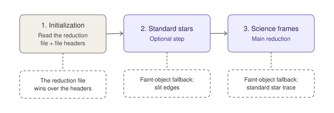
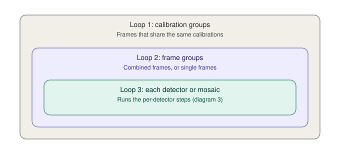
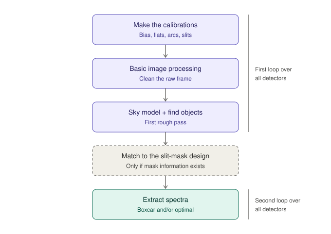
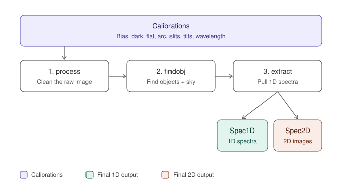
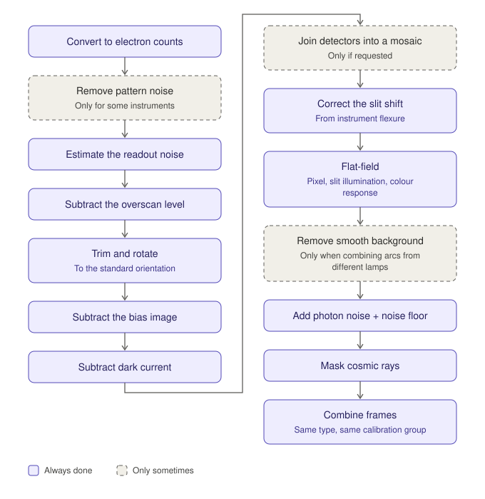
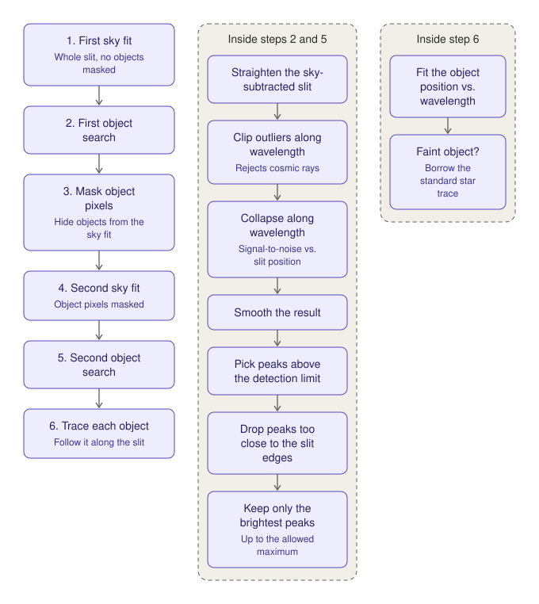
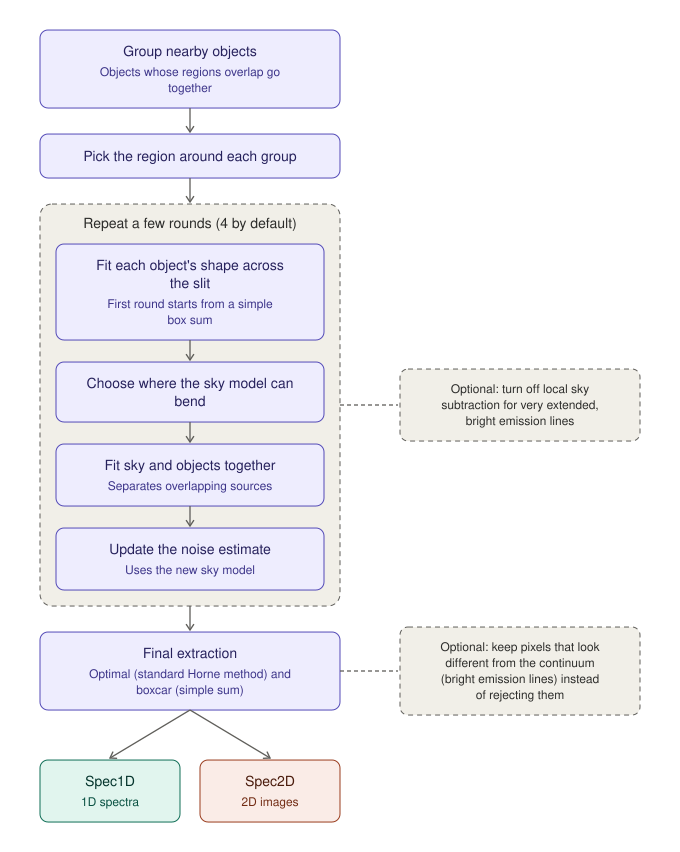

# PypeIt reduction workflow: block diagrams

The diagrams are standalone SVG pictures in the `diagrams/` folder, drawn by `make_diagrams.py`.

**How to change them**

1. Open `make_diagrams.py` and edit the text of any step. Each step looks like `("Title", "Subtitle", "colour", dashed)`, and everything after the title is optional.
2. Run `python3 make_diagrams.py`. The SVGs in `diagrams/` are rewritten.
3. Or open an SVG directly in a text editor, Inkscape or Illustrator and edit it by hand.

**Colour key (same in every diagram)**

| Colour | Meaning |
|---|---|
| Grey | Setup step; a dashed outline means "only done sometimes" |
| Purple | Reduction steps, and calibrations |
| Teal | Final 1D spectra (Spec1D) |
| Coral | Final 2D images (Spec2D) |

---

## 1. Overall workflow

Three stages, run in order. The standard star stage is optional. The faint-object fallback is the "crutch" used to follow objects that are too faint to trace directly.

## 2. The three nested loops

Both reduction stages (standard stars and science) repeat the same loops, from outermost to innermost.

## 3. What happens for each detector

The detectors are looped over twice: first to calibrate and find objects, then again to extract spectra.

## 4. The three steps and their outputs

### 4a. Inside "process" (basic image processing)

The order is always the same, for every type of frame. Never skip trimming and rotating: everything later expects the standard orientation.

### 4b. Inside "findobj" (find objects + sky)

Object finding is run twice: once on a rough sky model, and again after the objects have been masked out of the sky.

### 4c. Inside "extract"

Sky subtraction near each object and the fit of each object's shape are done together, round after round. Then the final spectra are pulled out.

---

## 5. The final products

| Output | Colour | What it is |
|---|---|---|
| Calibrations | Purple | Bias, dark, arc, slit edges, slit traces, flat field, wavelength mapping and solution (plus an alignment image for IFU data) |
| Spec2D | Coral | Calibrated 2D spectral images |
| Spec1D | Teal | Extracted 1D spectra |
| Bitmasks | Coral | Flags that go with the 2D output, marking bad pixels, cosmic rays and so on |
